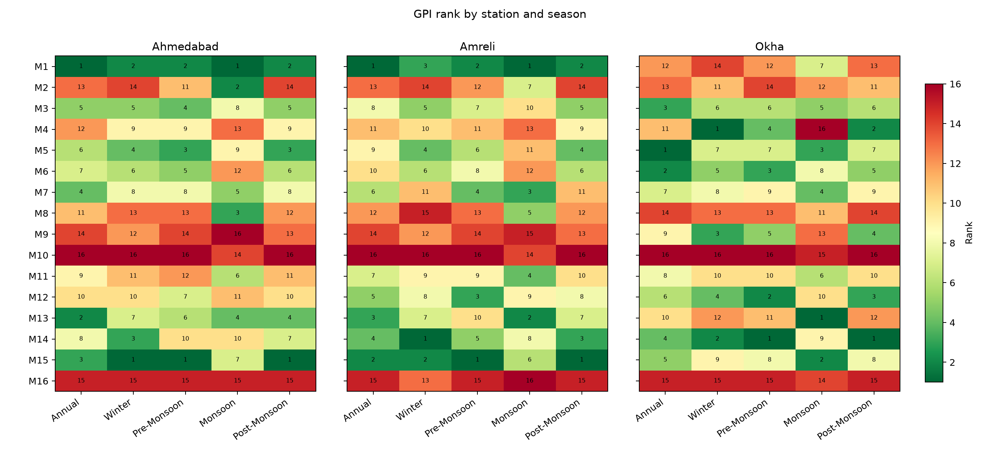
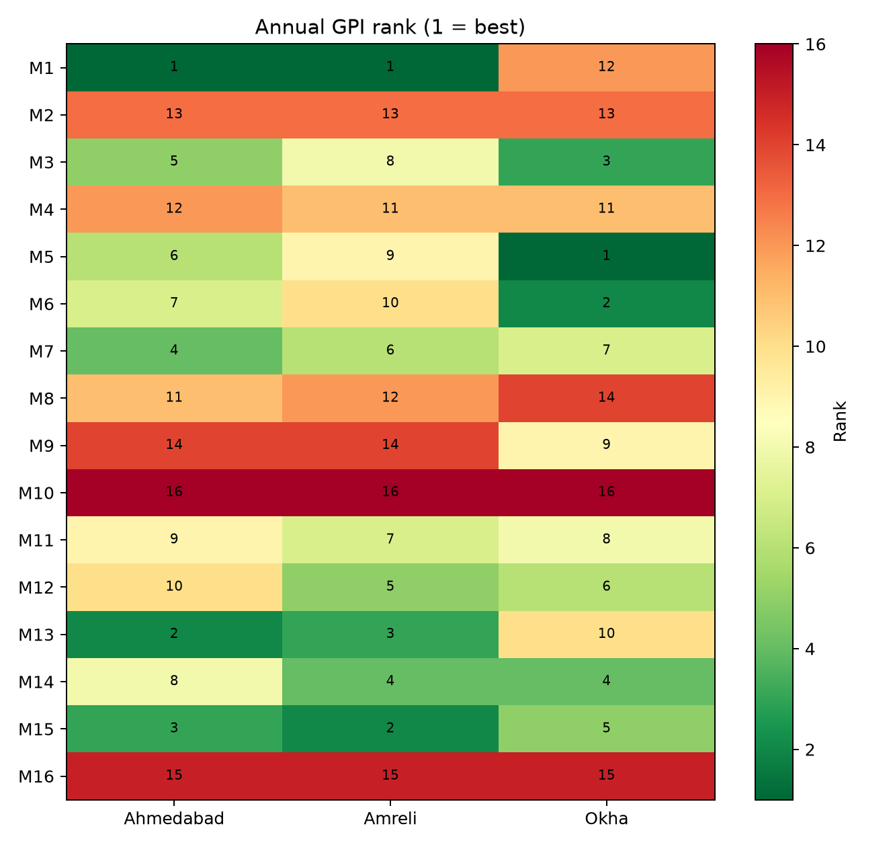
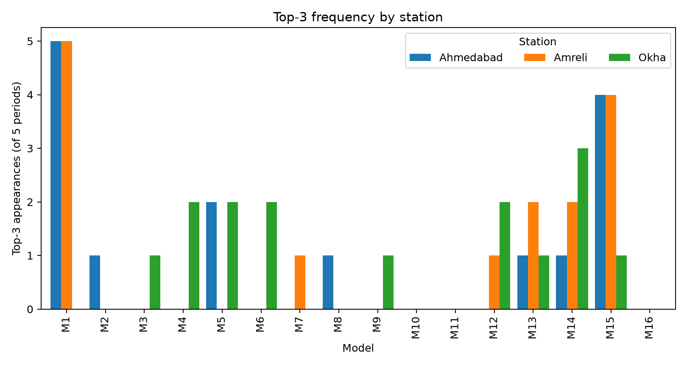
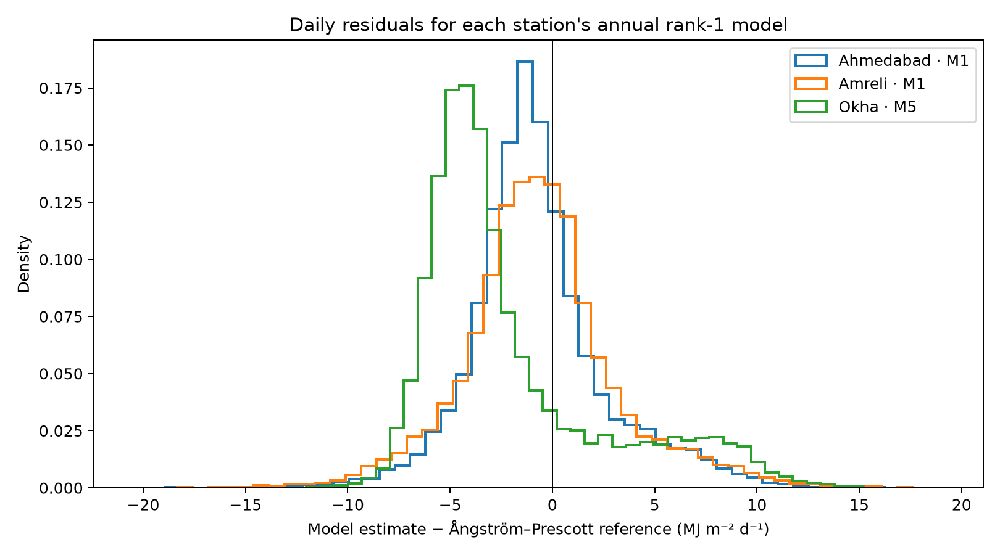

<div align="center">

# ☀️ Solar Radiation Model Explorer — Gujarat

**Which temperature-based model best estimates daily solar radiation where no pyranometer exists?**
16 published models, 3 IMD stations, 41 years of daily data, ranked season by season with a Global Performance Indicator.

[](code/solar_radiation_analysis.ipynb)
[](results/final)
[](dashboard)




</div>

---

## 📊 Key results

| | Result |
|---|---|
| 🥇 **Annual leader, Ahmedabad** | **M1** · then M13, M15 |
| 🥇 **Annual leader, Amreli** | **M1** · then M15, M13 |
| 🥇 **Annual leader, Okha** (coastal) | **M5** · then M6, M3 |
| 🔁 **Most consistent across all 15 station-periods** | M1 in the Top 3 ten times, M15 nine times, M14 six |
| ❌ **Never in a Top 3** | M10, M11, M16 |
| 📅 Data | 14,474 – 14,802 valid days per station, 1985–2025 (IMD) |

> The reference is the sunshine-based Ångström–Prescott estimate, **not a pyranometer measurement**. Rankings describe agreement with that reference method.

## 🔍 What makes it different

- **Every assumption written down** — where the source paper is ambiguous (M2 units, M8's Θ, the signed-MBE direction in GPI, the d<sub>r</sub> coefficient, the R² definition) the choice is stated and tested in a sensitivity table.
- **Seasonal, not just annual** — Winter, Pre-Monsoon, Monsoon and Post-Monsoon ranked separately at each station, because the best model changes with the season.
- **Nothing filled or patched** — raw IMD rows are kept as delivered; excluded days stay visible with a reason.
- **Reproducible end to end** — one notebook regenerates every table and figure; SHA-256 hashes and structural checks are exported with the results.
- **Use it on your own station** — the Streamlit dashboard runs the same 16 models on an uploaded file, kept separate from the official results.

## 🛰️ Data

**IMD** daily station records (T<sub>max</sub>, T<sub>min</sub>, bright sunshine hours) for **Ahmedabad · Amreli · Okha**, 1985–2025 · model equations from Karale et al. (2026), Table 2

## 📈 Figures

| Annual ranks | Top-3 frequency | Annual-winner residuals |
|---|---|---|
|  |  |  |

## 🚀 Run it yourself

```bash
python -m venv .venv
source .venv/bin/activate            # Windows: .venv\Scripts\activate
python -m pip install -r requirements.txt
```

| Want to… | Do this |
|---|---|
| Reproduce the study | Put the three authorised IMD files in `data/raw_imd/`, open `code/solar_radiation_analysis.ipynb`, **Kernel → Restart and Run All** |
| Explore the results | `cd dashboard && pip install -r requirements.txt && streamlit run app.py` |
| Run the dashboard tests | `cd dashboard && pip install -r requirements-dev.txt && pytest` |

The raw station files and `results/final/daily_predictions.csv` are not in Git, because redistribution permission for the IMD data has not been confirmed. All aggregate results and figures are.

<details>
<summary><b>Data coverage by station</b></summary>

The analysis reads only the three retained daily files under `data/raw_imd/`. Each has date (`YEAR`, `MN`, `DT`), maximum and minimum temperature (`MAX`, `MIN`, °C), and bright sunshine duration (`SSH`, hours). The supplied files are retained as delivered; no observations are filled, shifted, clipped or recalibrated.

| Station | File records | Raw date span | Valid daily records used | First–last valid date |
|---|---:|---|---:|---|
| Ahmedabad | 14,973 | 1985-01-01–2025-12-31 | 14,802 | 1985-01-01–2025-12-23 |
| Amreli | 14,959 | 1985-01-01–2025-12-31 | 14,718 | 1985-01-01–2025-12-31 |
| Okha | 14,958 | 1985-01-01–2025-12-31 | 14,474 | 1985-01-01–2025-12-31 |

The date spans above are not claims of complete daily coverage. See [`results/qc/year_coverage.csv`](results/qc/year_coverage.csv) for the valid day count in each station-year, [`results/qc/qc_report.csv`](results/qc/qc_report.csv) for exclusions, and [`results/qc/data_provenance.csv`](results/qc/data_provenance.csv) for source and usable spans. Different stations and years contribute different numbers of days.

</details>

<details>
<summary><b>Reference radiation: Ångström–Prescott</b></summary>

The supplied primary study, Karale, Misra, Ghosh & Latwal (2026), *Seasonal and regional evaluation of sixteen temperature-based solar radiation models for India using a Global Performance Indicator*, states Eq. 5 on p. 5 as:

\[
R_{s,AP}=\left(a+b\frac{n}{N}\right)R_a,
\qquad a=0.25,\quad b=0.50.
\]

Here, (R_{s,AP}) is the reference global solar radiation (MJ m⁻² day⁻¹), (n) is actual bright sunshine duration (hours), (N=24\omega_s/\pi) is maximum possible sunshine duration (hours), and (R_a) is extraterrestrial radiation (MJ m⁻² day⁻¹). The station latitude and day of year determine (N) and (R_a). The paper does not use Tmin/Tmax in this reference equation. Only days with (0\le n\le N) receive a reference value.

Solar geometry follows the supplied primary paper, Eq. 2–4, p. 5. In particular, the primary results use the printed Earth–Sun distance factor (d_r=1+0.003\cos(2\pi J/365)); the alternative 0.033 coefficient is reported as a sensitivity case. The implementation uses (G_{sc}=0.0820) MJ m⁻² min⁻¹ with the standard 24×60 conversion; the supplied paper appears to mislabel this constant's unit.

</details>

<details>
<summary><b>The 16 models (equations and assumptions)</b></summary>

All (R_s) outputs are treated as MJ m⁻² day⁻¹. (\Delta T=T_{max}-T_{min}), (T=(T_{max}+T_{min})/2), and (R_a) is extraterrestrial radiation. The equations below follow Karale et al. (2026), Table 2, pp. 7–8. Input requirements, source, units and interpretation notes are in the registry CSV.

| ID | Equation |
|---|---|
| M1 | (0.16\sqrt{\Delta T}\,R_a) |
| M2 | (3.6(1.29+0.3626\Delta T)) **(unit conversion assumption)** |
| M3 | (0.3124\Delta T^{0.2942}R_a) |
| M4 | ((0.7730-0.0296\Delta T+0.0016\Delta T^2)R_a) |
| M5 | ((0.2063+0.1801\ln\Delta T)R_a) |
| M6 | ((0.3040+0.1008\sqrt{\Delta T})R_a) |
| M7 | ((0.2889+0.1562T_{max}/T_{min})R_a) |
| M8 | ((1.7217-1.691\Theta)R_a, \Theta=T_{min}/T_{max}) **(interpretation assumption)** |
| M9 | ((0.28\ln\Delta T+0.15)R_a) |
| M10 | (-4.46+0.477R_a-0.226T) |
| M11 | ((0.4610+0.0029\Delta T)R_a) |
| M12 | ((0.5290+0.0516T_{min}/T_{max})R_a) |
| M13 | ((0.206590+0.026851T_{max}-0.024184T_{min})R_a) |
| M14 | ((0.85235-0.00997T)R_a) |
| M15 | ((0.236+0.106\sqrt{\Delta T})R_a) |
| M16 | ((0.00185\Delta T^2-0.0433\Delta T+0.4023)R_a) |

Primary Table 2 prints M2 as (H=1.29+0.3626\Delta T) without units; a supplied secondary companion instead writes it as (H/H_0). The sources do not establish the factor 3.6, which is retained only as an implementation assumption and compared with no conversion in the sensitivity analysis. M8's (\Theta) is undefined in the primary table and the original Falayi equation is not included in the supplied papers; the implementation uses (T_{min}/T_{max}) by analogy with M12, explicitly as an assumption. M16 follows the printed equation without adding a square root. These points require confirmation from the original cited papers/research group.

</details>

<details>
<summary><b>Inclusion rules and data quality</b></summary>

A daily row contributes to a station-period only when both temperatures and sunshine are present, (T_{max}>T_{min}), (0\le n\le N), and all 16 model outputs are finite. No minimum station-year completeness threshold is imposed. Each station-period requires at least 30 valid daily rows; the minimum is met for every reported cell. Excluded rows remain visible with reasons in `results/final/daily_predictions.csv`.

No station-year completeness filter is imposed. Potential date shifts or systematic sunshine-record errors that are not detectable through these row-level rules remain a limitation and need confirmation from the data provider or research group.

</details>

<details>
<summary><b>Evaluation metrics</b></summary>

For daily model estimate (P_i) and reference (O_i), calculated within each station and period:

- **RMSE** (=\sqrt{\frac1n\sum(P_i-O_i)^2}); lower is better.
- **MAE** (=\frac1n\sum|P_i-O_i|); lower is better.
- **MBE** (=\frac1n\sum(P_i-O_i)); positive values indicate overestimation, negative values underestimation, and zero is ideal.
- **R²** (=1-\frac{\sum(P_i-O_i)^2}{\sum(O_i-\bar O)^2}); higher is better. It is not clipped and may be negative.

</details>

<details>
<summary><b>GPI and ranking method</b></summary>

Karale et al. (2026), §2.3.1 and Table 3 (p. 8), first min–max scales each indicator across the 16 models in each station-period: (y_{ij}=(x_{ij}-\min x_j)/(\max x_j-\min x_j)). It then computes

\[
GPI_i=\sum_j\alpha_j(\tilde y_j-y_{ij}),\qquad
\alpha_{R^2}=-1,\quad\alpha_{RMSE}=\alpha_{MAE}=\alpha_{MBE}=+1,
\]

where (\tilde y_j) is the median scaled value. This is the paper's unweighted sum; no additional weights are used. Rank is descending GPI. GPI values are rounded to 10 decimal places for ranking; tied models share the best rank (`min` rank), so a Top 3 can contain more than three models in a tie. A constant indicator has a zero contribution rather than producing a division-by-zero result.

There is a material ambiguity in the paper: its text says MBE should be “closer to 0”, but its stated GPI direction ((+1) for error metrics, applied to signed MBE) rewards lower signed MBE and therefore may reward stronger negative bias. The primary results follow the printed formula literally. `results/validation/sensitivity_analysis.csv` reports absolute-MBE, Pearson-r², no-conversion M2, and alternative d_r=0.033 sensitivities. The paper's tabulated R² values behave like Pearson correlation squared rather than its stated (1-SSE/SST); the primary analysis uses the printed formula and records Pearson-r² separately. These are assumptions, not interchangeable definitions.

</details>

<details>
<summary><b>Every result file</b></summary>

- `results/final/all_metrics.csv`: all 240 station-period-model combinations, including metrics, GPI, rank, status and sample count.
- `results/final/annual_metrics.csv`, `results/final/seasonal_metrics.csv`, `results/final/annual_gpi.csv`, `results/final/seasonal_gpi.csv`: convenient filtered tables.
- `results/final/top_3_models.csv`, `results/final/model_ranking.csv`, `results/final/top3_frequency.csv`, `results/final/station_comparison.csv`, `results/final/district_comparison.csv`: rankings and summaries.
- `results/final/daily_predictions.csv`: source-day values, reference, all model estimates, inclusion flag and exclusion reason.
- `results/final/station_period_summary.csv`: usable sample sizes and date spans for each period.
- `results/model_registry.csv`: authoritative model definitions.
- `results/qc/data_provenance.csv`, `results/qc/year_coverage.csv`, `results/qc/qc_report.csv`: coverage and exclusions.
- `results/validation/sensitivity_analysis.csv`: effect of M2 units/conversion, R² definition, MBE treatment and the solar-geometry coefficient.
- `results/validation/output_hashes.csv`: SHA-256 fingerprints for exported result CSVs and figures.
- `results/validation/validation_checks.csv`: generated structural, finite-value and reproducibility checks.
- `results/final/model_cross_district_summary.csv`: cross-station model summary.
- `figures/final/`: annual ranks and metrics, seasonal ranks, Top-3 frequency, and annual-winner residuals.

</details>

<details>
<summary><b>Folder layout</b></summary>

```
code/solar_radiation_analysis.ipynb   sole source of the official analysis
data/raw_imd/                         three IMD inputs (kept local, not in Git)
results/final/                        metrics, GPI, rankings, summaries
results/qc/                           provenance, coverage, exclusions
results/validation/                   checks, sensitivity, output hashes
results/model_registry.csv            model definitions (generated)
figures/final/                        published figures
dashboard/                            Streamlit explorer + tests
Research_References/                  source papers
presentation/                         slide deck
```

</details>

## ⚠️ Limitations

The reference radiation is itself a model (Ångström–Prescott with fixed a = 0.25, b = 0.50), so a high rank means close agreement with that estimate, not with measured radiation. Three points in the source paper (M2's unit conversion, M8's Θ, M16's form) need confirmation from the original authors; the sensitivity table shows how much they move the rankings. Date shifts or systematic sunshine-record errors that pass the row-level checks would not be caught.

## 📚 Research source

Karale, P., Misra, V., Ghosh, K. & Latwal, S. (2026). *Seasonal and regional evaluation of sixteen temperature-based solar radiation models for India using a Global Performance Indicator*. Research Square preprint v1, DOI: 10.21203/rs.3.rs-8639991/v1. The supplied PDF is `Research_References/1. Seasonal_and_regional_evaluation_of_sixteen_temper.pdf`.

Other supplied research papers are preserved in `Research_References/`; they were reviewed as context and are not silently treated as substitutes for definitions absent from the main study.

## 👤 Maintainer

**Sathwik Ramaka** · M.Sc. Agriculture Analytics (DAU · AAU · IIRS-ISRO) · [LinkedIn](https://www.linkedin.com/in/sathwik-ramaka-1ba40227a/) · [GitHub](https://github.com/sathwikramaka)
